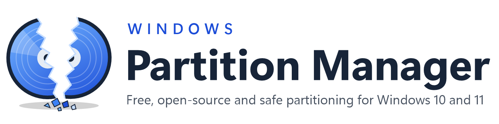
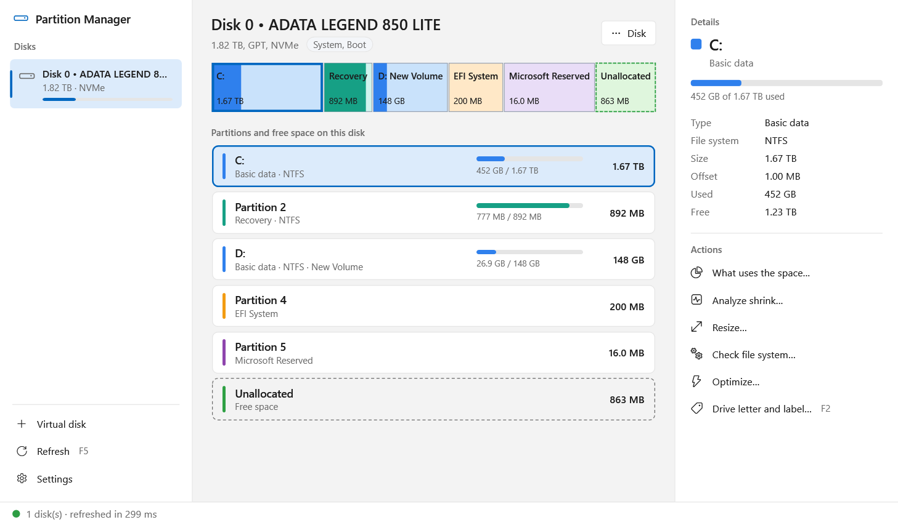
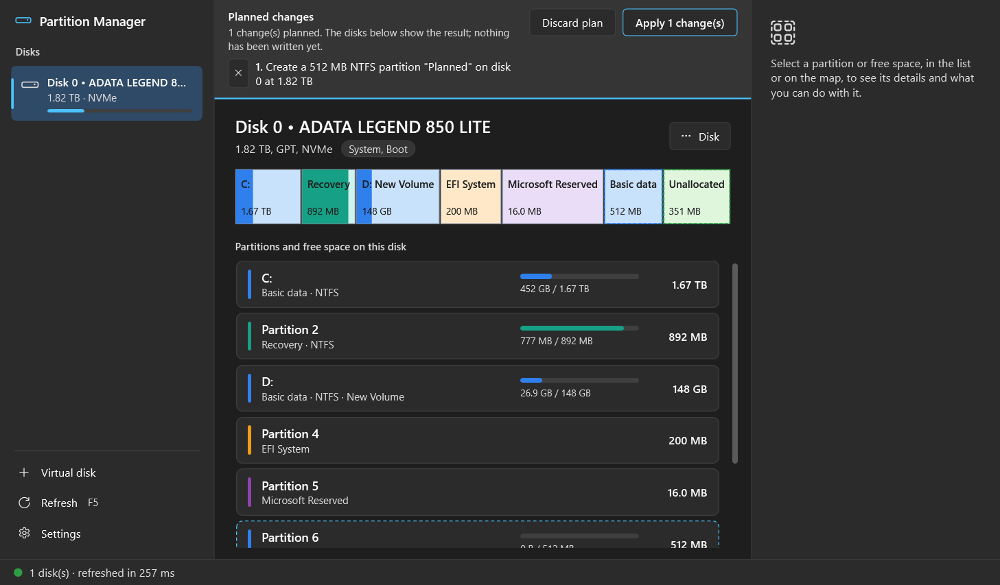
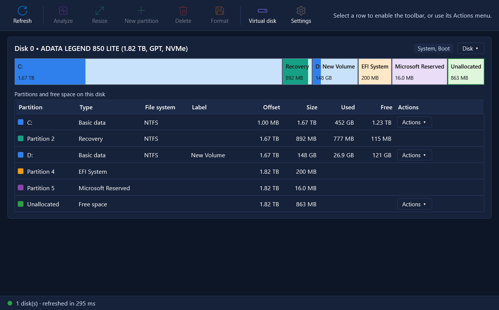

<p align="center">
  <picture>
    <source media="(prefers-color-scheme: dark)" srcset="docs/images/banner-dark.png">
    
  </picture>
</p>

<p align="center">
  <a href="https://github.com/kylehesi/windows-partition-manager/releases/latest"></a>
  <a href="https://github.com/kylehesi/windows-partition-manager/actions/workflows/ci.yml"></a>
  <a href="LICENSE"></a>
  
  
  
</p>

<p align="center">
  <a href="#installation"><b>Download</b></a> ·
  <a href="#features">Features</a> ·
  <a href="#command-line">Command line</a> ·
  <a href="#safety">Safety</a> ·
  <a href="docs/ARCHITECTURE.md">Architecture</a> ·
  <a href="CHANGELOG.md">Changelog</a>
</p>

**Windows Partition Manager** is a free, open-source partition manager for Windows 10 and 11.
It shrinks, extends, creates, formats and deletes partitions, explains *why* Windows refuses to
shrink a volume, and plans several changes on paper before anything is written. Every change
goes through the disk functions built into Windows; the program never writes raw sectors.

It exists because the built-in Disk Management often refuses to shrink a volume without saying
why, and the third-party alternatives are either abandoned or paid.

<p align="center">
  
</p>

## Contents

- [Features](#features)
- [Installation](#installation)
- [Getting started](#getting-started)
- [Command line](#command-line)
- [Safety](#safety)
- [Why Windows cannot shrink your disk](#why-windows-cannot-shrink-your-disk)
- [Building from source](#building-from-source)
- [Contributing](#contributing)
- [Roadmap](#roadmap)
- [License](#license)

## Features

**Partitions**

- **Resize**: shrink or extend NTFS and ReFS partitions together with their file system, and
  optionally turn the freed space into a new drive in the same step.
- **Create, format and delete** partitions (NTFS, exFAT, FAT32, ReFS), with a typed
  confirmation for anything destructive. Windows' own partitions are protected.
- **Drive letter and label**: change or remove a letter, rename a volume.
- **Pending operations queue**: plan several creates, deletes, resizes and formats, see the
  resulting layout, then apply them with one confirmation. The disk is read again before every
  step; the first surprise stops the run.

**Diagnosis**

- **Shrink analysis**: lists the files that Windows cannot move (page file, hibernation file,
  restore points, NTFS metadata) and how far the volume can really shrink. The **Unblock**
  wizard removes them temporarily and puts the settings back afterwards.
- **What uses the space**: reads the master file table and shows folders and files largest
  first, with drill-down; about 3 seconds for 700,000 files.
- **Disk health**: what the drive reports about itself (SMART): temperature, SSD wear, errors
  and power-on hours, with a plain verdict.
- **Check and repair** a file system (online scan, quick fix, full offline repair) and
  **optimize** a drive (TRIM for SSDs, defragmentation for hard disks).

**Disks**

- **Initialize** a new disk, **convert** an empty one between MBR and GPT, take a disk
  **offline** or make it **read-only**.
- **Virtual disks**: create, attach and detach VHD and VHDX files, the safe way to practise.
- **USB flash drives and external SSDs** work like internal disks.
- **BitLocker aware**: encrypted volumes are marked, locked ones are never resized or changed.

**Everyday use**

- Two layouts: **Modern** (the default, shown above) and **Classic**, a compact table of every
  disk. Switch in Settings.
- **White, Dark and Night** themes, a choice of UI font, **English and Turkish**.
- Keyboard shortcuts (F5 refresh, F2 drive letter and label, Del delete), automatic refresh when
  a drive is plugged in, and an **operation history** of every change.
- A full **command-line tool**, `wpm`, with JSON output for scripts.

<table>
  <tr>
    <td width="50%"></td>
    <td width="50%"></td>
  </tr>
  <tr>
    <td align="center"><sub>Dark theme, with one change waiting in the queue</sub></td>
    <td align="center"><sub>The Classic layout in the Night theme</sub></td>
  </tr>
</table>

## Installation

Windows Partition Manager runs on 64-bit Windows 10 and 11. The setup and the portable build
include the .NET runtime, so nothing else needs to be installed. The program asks for
administrator approval when it starts, because every change to a partition needs it.

> [!WARNING]
> The program checks every change before it is made, but changing partitions always carries
> some risk. **Back up your data first.** Installing or using the program means you accept the
> [disclaimer](#disclaimer) and the [MIT license](LICENSE).

### Setup (recommended)

1. Download **`WindowsPartitionManager-Setup.msi`** from the
   [latest release](https://github.com/kylehesi/windows-partition-manager/releases/latest)
   (the same file is in the root of this repository).
2. Double-click it, accept the license agreement, choose the install folder and approve the
   administrator prompt.
3. Leave **Launch Windows Partition Manager** ticked and click **Finish**.

The setup installs into `C:\Program Files\Windows Partition Manager`, adds shortcuts to the
desktop and the Start menu, and puts the `wpm` command-line tool on the PATH. A newer setup
upgrades an older installation in place. Uninstall from **Settings > Apps > Installed apps**.

Silent install and uninstall, from an administrator prompt:

```powershell
msiexec /i WindowsPartitionManager-Setup.msi /qn
msiexec /x WindowsPartitionManager-Setup.msi /qn
```

### Portable

`WindowsPartitionManager-<version>-portable-x64.zip` from the releases needs no installation and
leaves nothing behind except its settings and log in `%LOCALAPPDATA%\WindowsPartitionManager`.
Unzip it anywhere and run `WindowsPartitionManager.exe`, or `wpm.exe` from a terminal.

### "Windows protected your PC"

Releases are not code-signed yet, so Microsoft Defender SmartScreen may show this screen for a
downloaded copy. It is a reputation warning about an unknown publisher, not a virus detection:
choose **More info**, then **Run anyway**. Every release is built so as not to resemble malware
(no packers, no self-extracting executables, full version information, a standard Windows
Installer package) and is scanned with Microsoft Defender before publishing. Each release lists
SHA-256 checksums in `SHA256SUMS.txt`; check a download with
`certutil -hashfile WindowsPartitionManager-Setup.msi SHA256`.

## Getting started

Select a partition, in the list or on the disk map, and its details and actions appear on the
right. Right-click gives the same actions; the **Disk** menu holds what applies to the whole disk.

**A new drive from the free space of C:**

1. Select **C:** and choose **Analyze shrink…**. If Windows' limit is far above your data, the
   report names the files responsible, and **Unblock…** can remove them (some steps need a
   restart).
2. Choose **Resize…**, set the new size, tick **Create a partition in the freed space**, pick a
   file system, label and letter, and confirm.
3. If you used Unblock, open it again (or Settings) and choose **Restore previous settings**.

**Several changes at once:** in the new-partition, resize, format and delete dialogs choose
**Add to queue** instead of **Apply**. The disks then show the layout after the queued changes;
**Apply N changes** runs them in order, **Discard plan** forgets them.

**Practise first** on a virtual disk: **Virtual disk > Create virtual disk…** makes a VHDX that
appears like a real disk; **Disk > Detach virtual disk** removes it again, the file stays.

## Command line

`wpm` covers everything the app does. Listing works in a normal terminal; anything that analyses
or changes a disk needs one opened with **Run as administrator**. Write commands print a plan,
refuse on errors and ask for a typed confirmation unless `--yes` is given.

```powershell
wpm list                                    # disks, partitions and free space
wpm analyze C: --target 300GB               # why C: will not shrink to 300 GB
wpm resize 0 1 --shrink-by 500GB            # shrink partition 1 of disk 0 by 500 GB
wpm create 0 --max --fs NTFS --label Data   # a new drive in the largest free space of disk 0
wpm space C: --top 20                       # the largest folders and files on C:
wpm health                                  # what every drive reports about its health
```

<details>
<summary><b>All commands</b></summary>

| Command | What it does |
|---|---|
| `wpm list [--json]` | Disks, partitions and free regions; `--json` for scripts (sizes in bytes, with a `schemaVersion`). |
| `wpm analyze <letter> [--target <size>]` | How far an NTFS volume can shrink and which files block it. |
| `wpm resize <disk> <partition> (--size \| --shrink-by \| --extend-by) <size>` | Shrink or extend an NTFS or ReFS partition with its file system. |
| `wpm create <disk> (--size <size> \| --max) [--offset] [--fs] [--label] [--letter]` | Create and format a partition in unallocated space. |
| `wpm format <disk> <partition> [--fs] [--label] [--full]` | Reformat a partition in place; it keeps its letter. |
| `wpm delete <disk> <partition>` | Delete a partition and everything on it. |
| `wpm letter <disk> <partition> (<X> \| --remove)` | Change or remove a drive letter. |
| `wpm label <disk> <partition> <text>` | Rename a volume; `""` clears the label. |
| `wpm check <disk> <partition> [--spotfix \| --fix]` | Scan a file system, fix what a scan found, or run the full offline repair. |
| `wpm optimize <disk> <partition> [--trim \| --defrag]` | TRIM an SSD or defragment a hard disk; by default what suits the drive. |
| `wpm space <letter> [--top N]` | The largest folders and files, read from the master file table. |
| `wpm health [<disk>]` | SMART data: temperature, wear, errors, power-on hours. |
| `wpm convert <disk> (gpt \| mbr)` | Give an empty disk the other partition table. |
| `wpm disk <disk> (online \| offline \| readonly \| writable)` | Take a disk offline, bring it back, or switch read-only. |
| `wpm unblock <letter> [--hibernation] [--pagefile] [--shadows] [--all]` | Remove what stops a shrink; `wpm unblock --restore` puts it back. |
| `wpm vhd new <file.vhdx> --size <size>` | Create a VHDX, attach it and initialize it with GPT. |
| `wpm vhd attach <file>` / `wpm vhd detach <file>` | Attach or detach a VHD or VHDX; the file is kept. |
| `wpm layout <letter> [--limit N]` | Dump the raw NTFS file layout; a debugging aid. |

Sizes accept units such as `512MB`, `300GB` or `1.5TB`. `wpm help` prints the full reference.

</details>

## Safety

The program **never writes raw sectors**. Every change goes through the Windows Storage
Management API, the same calls as PowerShell's `New-Partition` and `Resize-Partition`, so an
interruption lands in mechanisms Windows already handles:

- **Create and delete** touch only the partition table, which GPT keeps in two CRC-protected
  copies.
- **Format** writes only inside the target partition.
- **Shrink and extend** are journaled by NTFS. In testing, pulling a disk out in the middle of a
  shrink left every file intact.

On top of that the program:

- shows a plan and asks for confirmation, with a typed name for anything destructive;
- re-reads the disk right before writing and refuses if it changed since you looked (another
  tool, or a USB drive swapped);
- refuses volumes that are dirty, locked by BitLocker or still being encrypted;
- refuses to resize Windows on battery, and anything below 30 % charge;
- keeps the computer awake during an operation;
- removes a half-created partition again if formatting it fails;
- logs every attempt to `%LOCALAPPDATA%\WindowsPartitionManager\operations.log`, shown in
  **Settings > Show history**.

Every write path is exercised by integration tests on throwaway virtual disks, including a
rehearsal on a copy of a real disk layout that verifies every file by hash after each step.

## Why Windows cannot shrink your disk

NTFS keeps some files that Windows will not move while the volume is mounted: parts of the
Master File Table, the NTFS log, the page file, the hibernation file and System Restore storage.
Disk Management only shrinks a volume down to the last such file, so a single one near the end
of a 2 TB disk can block the whole operation. The analysis finds them by reading the volume's
file layout directly (read-only); the page file, the hibernation file and restore points can be
removed temporarily, NTFS metadata cannot.

## Building from source

Requirements: Windows 10 or 11 and the [.NET 10 SDK](https://dotnet.microsoft.com/download).

```powershell
git clone https://github.com/kylehesi/windows-partition-manager.git
cd windows-partition-manager
dotnet build
dotnet run --project src\WindowsPartitionManager.App              # the desktop app
dotnet run --project src\WindowsPartitionManager.Cli -- list      # the command-line tool
```

Tests:

```powershell
dotnet test tests\WindowsPartitionManager.Core.Tests
dotnet test tests\WindowsPartitionManager.App.Tests
dotnet test tests\WindowsPartitionManager.Integration.Tests   # elevated prompt; uses temporary VHDX files only
```

<details>
<summary><b>Building the installer and the portable build</b></summary>

Install [WiX Toolset 5](https://wixtoolset.org) and its two extensions once:

```powershell
dotnet tool install --global wix --version 5.0.2
wix extension add -g WixToolset.UI.wixext/5.0.2
wix extension add -g WixToolset.Util.wixext/5.0.2
```

Then:

```powershell
powershell -ExecutionPolicy Bypass -File build\package.ps1
```

The script runs the unit tests, publishes the self-contained app and CLI, writes
`WindowsPartitionManager-Setup.msi` to the repository root and the versioned MSI, the portable
zip and `SHA256SUMS.txt` to `artifacts\`, and scans everything with Microsoft Defender. Set
`WPM_SIGN_THUMBPRINT` to a code-signing certificate's thumbprint to sign the executables and the
installer.

</details>

[docs/ARCHITECTURE.md](docs/ARCHITECTURE.md) describes the internals: the projects and layers,
how an operation travels from a click to the disk, the safety model, the tests and the Windows
behaviours the design works around.

## Contributing

Bug reports, ideas and pull requests are welcome. Please open an
[issue](https://github.com/kylehesi/windows-partition-manager/issues) first for larger changes.

- Never test against your own disks: use a virtual disk (`wpm vhd new`) or the integration
  tests, which create and delete their own.
- Changes to a disk go through a planner in `WindowsPartitionManager.Core`, the Storage
  Management API in `WindowsPartitionManager.Platform.Windows`, a confirmation in the UI and a
  test on a VHDX.
- UI text is localizable; [docs/ADDING_A_LANGUAGE.md](docs/ADDING_A_LANGUAGE.md) explains how to
  add a translation.
- `dotnet build -c Release -warnaserror` and the unit tests must pass; CI runs both on every
  pull request.

## Roadmap

- [x] Disk map, partition table, resize, create, format, delete, initialize
- [x] Shrink analysis and the Unblock wizard
- [x] USB flash drives, external SSDs and virtual disks
- [x] MSI installer and portable build, scanned with Microsoft Defender
- [x] English and Turkish; White, Dark and Night themes
- [x] Drive letters and labels, disk health, check and optimize, BitLocker awareness
- [x] Space analysis and the pending operations queue
- [x] Modern layout
- [ ] Code signing through the SignPath Foundation (removes the SmartScreen warning)
- [ ] winget package
- [ ] Offline NTFS metadata relocation for non-system volumes

See the [changelog](CHANGELOG.md) for what changed in each version.

## License

Windows Partition Manager is free software under the **[MIT License](LICENSE)**. Copyright
© 2026 Windows Partition Manager contributors. The components it is built on keep their own
licenses, listed in [THIRD-PARTY-NOTICES.md](THIRD-PARTY-NOTICES.md). Windows is a trademark of
Microsoft Corporation; this project is not affiliated with or endorsed by Microsoft.

### Disclaimer

In short: the program is careful, but changing partitions always carries some risk. Back up
your data first. The authors cannot take responsibility for your data.

<details>
<summary><b>Full disclaimer</b> (part of the license agreement the setup asks you to accept)</summary>

1. Windows Partition Manager is free, open-source software, provided "as is" and "as
   available", without warranty of any kind, express or implied, including but not limited to
   the warranties of merchantability, fitness for a particular purpose and non-infringement.
2. Changing partitions is never completely free of risk. Hardware faults, power failures, other
   software, or choosing the wrong partition can lead to loss of data. The program checks every
   change before it is made and uses only the disk functions built into Windows, but it cannot
   rule these risks out.
3. You use the program at your own risk. You are responsible for backing up your data before
   creating, resizing, formatting or deleting partitions, and for checking that each change is
   the one you intend.
4. To the maximum extent permitted by applicable law, the authors and contributors of Windows
   Partition Manager shall not be liable for any loss or corruption of data, damage to hardware
   or software, loss of time, loss of profit, or any other direct, indirect, incidental, special
   or consequential damage arising from the use of, or the inability to use, the program, even
   if advised of the possibility of such damage. No claim of any kind is accepted against the
   authors or contributors on these grounds.
5. Nothing in this notice limits any liability that cannot be limited or excluded under the law
   that applies to you.

By installing, copying or using Windows Partition Manager you confirm that you have read,
understood and accepted these terms and the MIT license. If you do not accept them, do not
install or use the program. The same text ships as [DISCLAIMER.txt](DISCLAIMER.txt).

</details>
